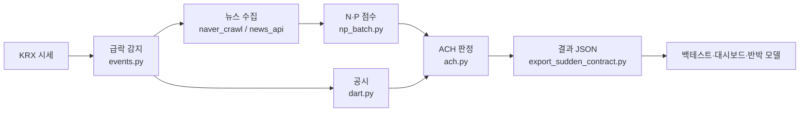
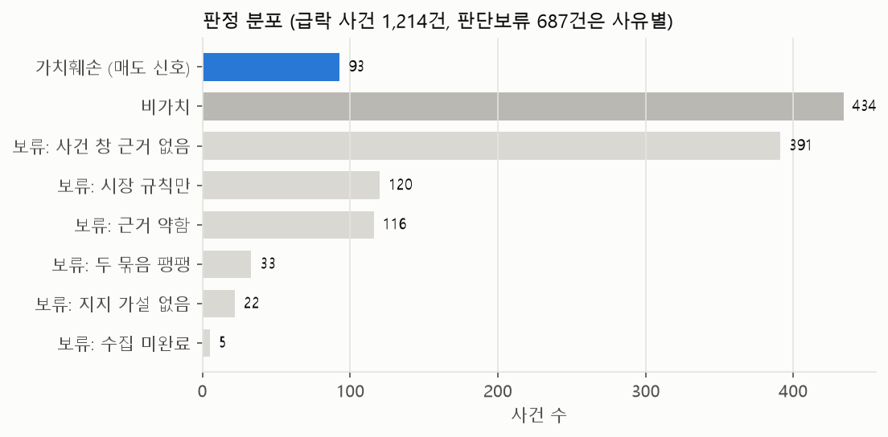
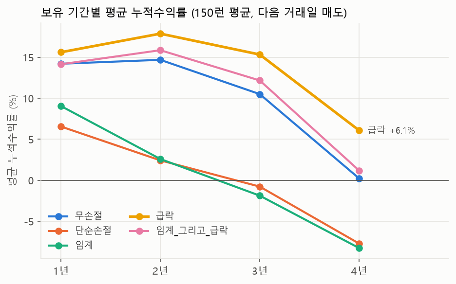
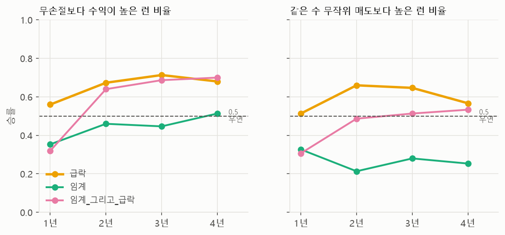
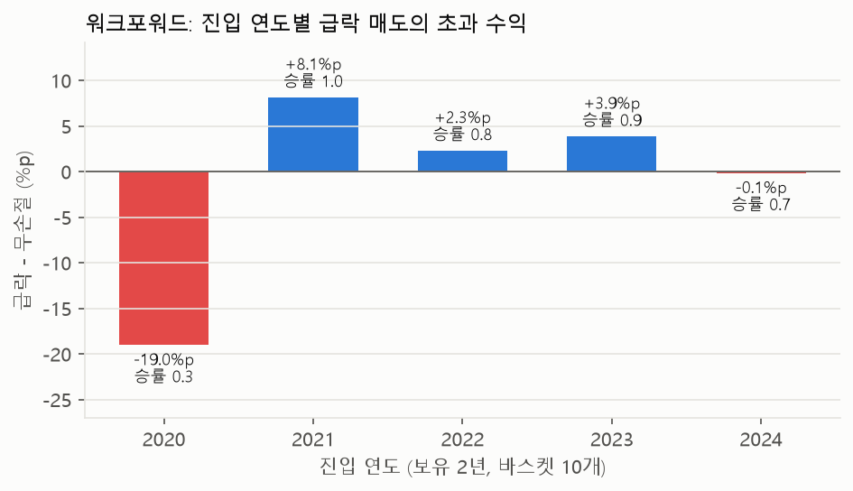

# 급락 모델 총정리 (통합 담당자용)

작성 2026-11-21. 대상: 서서히·급락·반박(의견 검증) 세 모델을 하나의 서비스로 묶고 실시간 데이터에 연결하는 사람.
자세한 이력과 숫자는 [`models/sudden/README.md`](../models/sudden/README.md), 설계와 바뀐 이유는 [`sudden_model.md`](sudden_model.md), 뉴스 API 전환은 [`sudden_live_api.md`](sudden_live_api.md)에 있다.

---

## 1. 한 줄 요약

**급락 모델은 "보유 종목이 하루에 크게 빠졌을 때, 그 이유가 회사 가치가 상한 것인지(가치훼손) 아닌지(비가치)를 뉴스·공시로 판정"한다.**
결과는 사건마다 `가치훼손 / 비가치 / 판단보류` 중 하나와 근거(기사 URL·공시)다.

- 파이널 시험(120종목, 2020~2026, 급락 1,214건)에서 **가치훼손 판정 다음 날 파는 전략은 무손절보다 나았고, 같은 수의 무작위 매도보다도 2~3년 보유에서 뚜렷하게 나았다.**
- 이 우위는 진입 분기 단위 부트스트랩에서 2~4년 보유에 유의했다(무손절 대비 p ≤ 0.002). **그러나 판정과 상관없이 "급락한 종목은 다음 날 다 판다"도 비슷하게 나왔다.** 급락 종목은 판정과 무관하게 1년 동안 시장보다 약 20% 덜 올랐기 때문이다. 판정이 보태는 것은 "같은 효과를 훨씬 적게 팔고(바스켓 20종목 중 2~6개 vs 11~15개) 얻는다"와 "3개월 동안은 가치훼손이 비가치보다 8.7%p 더 빠진다(p 0.018)"이다(3.2절).
- 사건의 57%가 판단보류다. **매도 "권유"가 아니라 "이 급락은 왜 일어났나"를 근거와 함께 보여 주는 용도**로 쓰는 것이 맞다.

---

## 2. 무엇을 하나



| 단계 | 하는 일 | 코드 | 외부 자원 |
|---|---|---|---|
| 1. 급락 감지 | 시장모형 비정상수익률 z ≤ -1.96, 보통주·시가총액 1,000억 이상 | `events.py --v31` | KRX(pykrx) |
| 2. 뉴스 수집 | 급락일 앞 2세션 ~ 급락일 15:30 기사(사건 창) + 평소 기사(앞 180일) | `crawl_plan.py`, `naver_crawl.py` (운영은 `news_api.py`로 전환 중) | 네이버 |
| 3. N·P 점수 | 기사마다 "행동·대상·금액" 사실을 뽑아 새 소식인지(N), 얼마나 퍼졌는지(P) 계산 | `np_batch.py`, `news_facts.py`, `llm_facts.py`, `p_pool.py` | OpenAI gpt-5-nano |
| 4. 공시 | 필수 공시(증자·CB·감사의견 등)와 실적 공시를 근거 단위로 | `dart.py`, `earnings.py` | OpenDART |
| 5. ACH 판정 | LLM은 기사를 "정보 단위"로 나누고 유형만 붙인다. 판정은 코드가 관계표로 계산 | `ach.py`, `market_rules.py` | OpenAI gpt-5-mini (3회 다수결) |
| 6. 결과 형식 | 사건별 판정·점수·플래그·근거를 JSON으로 | `export_sudden_contract.py` | - |

### 판정 방식 (ACH: 경쟁 가설 분석)
- 가설 5개: **H1 펀더멘털 훼손, H2 지분 희석** (→ 가치훼손) / **H3 심리성(시장·업종 분위기), H4 수급, H5 미확인 정보(소문·오보)** (→ 비가치).
- LLM은 기사 문장을 유형(F1 실적 하향, C1 지분 희석, M1 시장 충격 등 21종)과 방향(긍정·부정)으로 분류만 한다. 가설은 LLM에게 보여 주지 않는다.
- 코드가 유형 → 가설 관계표(`ach._REL`)로 지지·반증 점수를 더하고, 반증이 가장 적은 가설을 고른다. 근거가 약하거나 엇갈리면 판단보류.
- 그래서 같은 입력이면 판정은 재현된다(LLM 답은 캐시).

### 판단보류 사유 (서비스 문구로 그대로 쓸 수 있다)

| 코드 | 뜻 |
|---|---|
| `no_evidence_in_window` | 급락 직전·당일에 회사 관련 기사·공시가 없다 |
| `market_rule_only` | 시장 전체 하락 같은 시장 규칙만 해당한다 |
| `weak_support` | 이긴 가설의 근거가 너무 약하다 (최대 지지의 25% 미만) |
| `competing_groups_too_close` | 가치훼손 쪽과 비가치 쪽 근거가 팽팽하다 |
| `no_supported_hypothesis` | 어떤 가설도 지지받지 못했다 |
| `collection_incomplete` | 기사 수집이 끝나지 않았다 |

### 고정 설정 (2026-11-17 동결, 바꾸지 않는다)
분류 지시문 `ach-units-3`, `ach.py --model gpt-5-mini --market-only-holds --min-support-ratio 0.25`, 회사명 엄격 매칭(`news_review.STRICT_NAMES = True`). 운영(`live.py`)도 같은 설정이다.

---

## 3. 성능

### 3.1 파이널 시험 (120종목, 2020~2026, 1,214건) — 대표 결과

결과를 보고 설정을 바꾸지 않은 1회 시험이다. 튜닝 표본과 겹치는 10건을 뺀 판(1,204건)도 돌렸고 숫자가 완전히 같았다(빠진 10건 중 매도 신호는 1건뿐이고 어느 런에서도 매도일을 바꾸지 않았다).

**판정 분포**



- 가치훼손(매도 신호) 93건(7.7%), 비가치 434건, 판단보류 687건(57%).
- 판단보류의 대부분(391건)은 사건 창에 회사 기사가 없는 경우다. 수집 결측(외부 기사 실패 677건)도 일부 영향이 있다.

**스트레스 테스트** — 팀 `run_stress`와 같은 규칙: 무작위 진입일 × 120종목 중 무작위 20종목 바스켓, 보유 1~4년 각 150런, 신호 다음 거래일 종가에 매도, 한 번 팔면 다시 사지 않는다.





| 보유 | 급락 평균 수익 | 무손절 | 급락 MDD | 무손절 MDD | 승률 vs 무손절 | 승률 vs 같은 수 무작위 매도 | 평균 매도 수 |
|---|---:|---:|---:|---:|---:|---:|---:|
| 1년 | 15.6% | 14.2% | 22.5% | 24.3% | 0.56 | 0.51 | 1.9 |
| 2년 | 17.9% | 14.7% | 31.9% | 35.2% | 0.67 | 0.66 | 3.4 |
| 3년 | 15.3% | 10.5% | 37.7% | 42.4% | 0.71 | 0.65 | 4.6 |
| 4년 | 6.1% | 0.2% | 43.9% | 50.3% | 0.68 | 0.57 | 6.0 |

- 급락 매도는 모든 보유 기간에서 무손절보다 수익이 높고(+1.4~5.9%p) MDD가 낮다(1.8~6.4%p).
- **무작위 매도 대비 우위는 2~3년에서 가장 크다(0.65~0.66).** 1년은 우연 수준(0.51)이다.
- 임계 모델 단독 매도와 단순손절(-20%)은 무손절보다 나빴다(무작위 대비 0.21~0.33). 임계와 급락이 둘 다 나와야 파는 결합은 급락 단독보다 수익이 높았던 기간이 없다.
- 유의성과 "판정이 정말 도움이 되나"는 바로 아래 3.2절.

**워크포워드 (진입 연도 고정, 바스켓 10개, 보유 2년)**



- 2020년 진입만 크게 졌다(-19.0%p). 코로나 급락 뒤 반등장에서 판 비용이다.
- 2021~2023 진입은 무손절보다 나았고, 2024는 비겼다. 무손절 대비 승률은 2021~2024 진입에서 0.7~1.0.

### 3.2 유의성 검정과 분류 대조군 (2026-11-21)

파이널 결과를 다시 판정하지 않고, 이미 나온 판정·런으로 "우연과 구별되나", "판정이 실제로 일을 하나"를 봤다(`models/sudden/significance.py`).
p는 한쪽(전략이 낫다는 쪽) 부트스트랩 근사, 구간은 95%.

**(1) 스트레스 런: 무손절·무작위 매도보다 나은가** — 런 150개를 진입 분기(12~24개)로 묶어 재표집. 보유 기간이 분기보다 길어 이웃 분기도 겹치므로 실제 불확실성은 이보다 크다.

| 보유 | 급락 − 무손절 | p | 급락 − 같은 수 무작위 매도 | p |
|---|---|---|---|---|
| 1년 | +1.4%p [−0.0, +3.3] | 0.029 | +1.9%p [+0.1, +4.2] | 0.020 |
| 2년 | +3.2%p [+1.2, +5.5] | <0.001 | +4.0%p [+1.5, +6.3] | 0.002 |
| 3년 | +4.8%p [+2.9, +6.8] | <0.001 | +5.1%p [+2.1, +8.2] | 0.001 |
| 4년 | +5.9%p [+2.1, +9.6] | 0.002 | +2.8%p [−1.4, +7.4] | 0.10 |

**(2) 분류 대조군: 판정 대신 다른 규칙으로 팔면?** — 같은 런(같은 진입일·바스켓)에서 매도 규칙만 바꿨다.

| 보유 | 급락 − 아무급락¹ | p | 승률 | 급락 − 비가치급락² | p | 승률 |
|---|---|---|---|---|---|---|
| 1년 | +0.8%p [−2.0, +4.1] | 0.31 | 0.41 | +1.8%p [−0.3, +4.3] | 0.050 | 0.47 |
| 2년 | −0.7%p [−6.1, +5.6] | 0.62 | 0.35 | +0.9%p [−2.0, +4.3] | 0.29 | 0.43 |
| 3년 | −0.5%p [−7.6, +6.6] | 0.56 | 0.34 | +5.0%p [+0.7, +9.9] | 0.011 | 0.53 |
| 4년 | −6.1%p [−18.0, +5.9] | 0.85 | 0.31 | +8.3%p [+0.3, +17.4] | 0.021 | 0.53 |

¹ 판정과 상관없이 종목별 첫 급락 다음 날 매도 (매도 중앙 11~15종목). 급락(가치훼손)은 2~6종목.
² 첫 '비가치' 급락 다음 날 매도 (판정이 반대로 말할 때). 매도 중앙 6~11종목.

**(3) 사건 연구: 매도 뒤 그 종목은 어떻게 됐나** — 매도일(급락 다음 거래일) 이후 H 거래일, 120종목 동일가중 대비 초과수익. 종목 단위로 묶어 재표집.

| 기간 | 가치훼손 (69~93건) | 비가치 (375~432건) | 판단보류 | 가치훼손 − 비가치 | p |
|---|---|---|---|---|---|
| 20일 | −1.2% | −1.7% | −1.3% | +0.6%p [−4.5, +5.7] | 0.58 |
| 60일 | −12.4% | −3.7% | −4.0% | **−8.7%p [−16.5, −0.7]** | 0.018 |
| 120일 | −11.6% | −8.5% | −11.2% | −3.1%p [−17.1, +11.7] | 0.32 |
| 250일 | −21.6% | −18.2% | −20.6% | −3.4%p [−24.7, +17.3] | 0.36 |

**읽는 법**
- 급락 매도가 보유·무작위 매도보다 나은 것은 우연으로 보기 어렵다(2~3년이 가장 확실).
- 그 우위의 대부분은 "판정"이 아니라 "급락 뒤에는 판다" 자체에서 온다. 급락 종목은 비가치 판정을 받아도 1년 뒤 시장보다 약 18% 낮았다. 설계의 전제("비가치 급락은 회복한다")는 이 표본에서 성립하지 않는다.
- 판정이 보태는 것: 매도를 3~5배 적게 하면서 아무급락과 통계적으로 구분되지 않는 수익(다만 점추정은 2~4년에서 아무급락이 조금 높고, 승률은 0.31~0.41), 3개월 시계에서 가치훼손이 비가치보다 확실히 나쁨, 비가치급락에 파는 것보다 3~4년에서 나음.
- 기간 4개를 봤으므로 60일 결과를 본페로니 보정하면 p ≈ 0.07이다. 사전 등록한 검정이 아니므로 탐색 결과로 읽는다.

### 3.3 이전 검증 (흐름 파악용)

| 표본 | 무엇을 봤나 | 결과 |
|---|---|---|
| 개발 19종목 2016~2019 (단일 진입) | 가치훼손 판정 매도 vs 보유 | +12.9% (보유 +7.6%), MDD 18.4% (보유 44.7%). 그러나 무작위 매도와 구분되지 않음 (백분위 0.28~0.52) |
| 19종목 결합 시험 | 급락 + 서서히 결합 | 결합이 서서히 단독보다 나쁨 → 채택 안 함 |
| 2026 새 기간 100건 (사전 등록) | 판정별 사후 주가 CAR(1,60) | 비가치 -2.2% vs 가치훼손 -18.6%, 처음으로 기대 방향이지만 p 0.24 (유의하지 않음), 사건 한 건이 차이를 만듦 |
| 2015~2019 사후 펀더멘털 | H2 판정 → 실제 주식 수 증가 | 희석률 +28.9% vs 비가치 +10.3% (p 0.002). H1은 사건이 적어 판단 불가 |

### 3.4 그래서 어떻게 읽어야 하나
- **된 것**: 큰 표본(120종목, 7년)에서 "가치훼손 판정 다음 날 매도"는 보유와 무작위 매도보다 유의하게 나았다. 개발 표본과 방향은 같고 더 뚜렷하다.
- **조건부**: 같은 효과의 대부분은 "급락하면 판다"만으로도 나온다. 판정의 값은 매도 횟수를 줄이고, 3개월 안의 추가 하락을 구분하는 데 있다. **비가치 판정을 "회복할 것" 신호로 쓰면 안 된다.**
- **안 된 것**: 개별 판정의 정확도는 사람 검수에서 판정 일치 4/12, 단위 유형 일치 0.5 수준이다. 판정의 절반 정도는 선정 기사 하나에 따라 바뀐다(`doc_fragile`).
- **서비스 문구**: "매도하세요"가 아니라 "이 급락은 ○○ 공시·기사로 보아 가치훼손 쪽 근거가 더 많다 (근거 n개, 판정 불안정 여부)"로 보여 준다.

---

## 4. 통합할 때 쓰는 출력 (계약 JSON)

모든 소비자(대시보드·백테스트·반박 모델)는 **이 파일만 읽고 판정을 다시 계산하지 않는다.** 스키마: [`contracts/sudden_result.schema.json`](../contracts/sudden_result.schema.json).

| 파일 | 내용 |
|---|---|
| `contracts/sudden_result_live_<YYYYMMDD>.json` | 매일 운영 결과 (그날 급락 사건) |
| `contracts/sudden_result_team120_2020_2026.json` | 파이널 시험 결과 (git에 있음. 1,214건, 설정 고정 1회 결과) |

사건(`cases[]`) 하나의 주요 필드:

| 필드 | 뜻 | 화면에서 |
|---|---|---|
| `drop_id` | `<종목코드>_<YYYYMMDD>` | 키 |
| `stock_code`, `company_name`, `market`, `drop_date` | 종목·날짜 | 표시 |
| `decision_time` | 판정에 쓴 정보의 마감(급락일 15:30). 매매는 다음 거래일부터 | 백테스트 시점 기준 |
| `z`, `ar_pct` | 급락 크기 (시장 대비 비정상수익률) | "시장보다 -x% 더 빠짐" |
| `verdict` | `가치훼손` / `비가치` / `판단보류` | 핵심 표시 |
| `hypothesis`, `runner_up` | 이긴 가설과 2등 (H1~H5) | "주된 이유" |
| `hold_reason` | 판단보류 사유 코드 (2절 표) | 보류일 때 설명 |
| `scores.support`, `scores.refute` | 가설별 지지·반증 합 | 상세 보기 |
| `flags.fragile`, `flags.doc_fragile` | 판정이 근거 하나에 흔들림 | "판정 불안정" 배지 |
| `flags.mixed`, `flags.low_confidence`, `flags.unverified_basis` | 근거 엇갈림, 낮은 신뢰, 확인 안 된 근거 | 경고 |
| `inputs.news_docs`, `dart_units`, `market_units` | 쓴 기사·공시·시장 규칙 수 | "근거 n개" |
| `evidence[]` | 근거 단위: 출처(news/dart), 유형, 방향, 가중치, 짧은 라벨, 기사 URL | 근거 목록 (본문·발췌는 넣지 않는다, 저작권) |

**매도 신호로 쓰는 규칙** (백테스트와 같게): 종목별로 보유 기간 안의 첫 `verdict == "가치훼손"` 사건 → 다음 거래일 종가에 매도. `stress.py`의 `sudden_schedule()`이 기준 구현이다.

---

## 5. 실시간 운영 (지금 상태)

- **매일 실행**: Windows 작업 스케줄러가 평일 18:30에 `models/sudden/run_live_daily.cmd`(= `live.py --date today --log --skip-done`)를 돈다.
  단계: `prices → events → names → crawl → np → dart → ach → export`. 한 날짜를 처음부터 끝까지 돌린다.
- **상태 확인**: `models/sudden/cache/live/<날짜>/run_status.json`의 `result`(`done` / `no_events` / `market_closed` / `failed` / `running`), `verdicts`, `error`. 로그는 `cache/live/logs/<날짜>.log`.
- **걸리는 시간·비용**: 하루 약 1.5시간, OpenAI 호출 nano 약 1,400회 + mini 약 400회 (사건 수에 비례).
- **필요한 키** (`.env`, 값은 사람이 넣는다): `OPENAI_API_KEY`, `OPENDART_API_KEY`, `NAVER_API_HUB_CLIENT_ID`, `NAVER_API_HUB_CLIENT_SECRET`, `KRX_ID`, `KRX_PW`(KRX 시세, pykrx). 서버에서는 KRX Open API 인증키로 바꾼다(5.1).
- **사후 성적표**: `models/sudden/forward_ledger.py`가 실시간 판정 파일을 모아 사건별 5·20·60·120·250거래일 뒤 수익률과 시장 지수(KOSPI·KOSDAQ) 대비 초과수익을 붙인다(`cache/live/forward_ledger.csv`, `forward_summary.json`). 만기 전 칸은 비우고, 설정 고정(2026-11-20) 뒤 사건은 `after_freeze`로 따로 집계한다. live.py와 스케줄러는 건드리지 않으므로 아무 때나 다시 돌리면 된다. 실패한 날(`run_days.failed`)도 함께 적어 빈 날을 숨기지 않는다. 2026-11-21 기준 78건, 5일 만기 36건, 고정 뒤 사건은 아직 없다.
- **뉴스 수집 전환 중**: 지금은 네이버 검색 결과 페이지를 긁는다(차단·구조 변경 위험). 공식 NAVER API HUB로 바꾸는 코드(`news_api.py`, `live.py --news-source api`)가 있고, 병행 검증(`live_api_shadow.py`) 결과를 12월 초에 보고 전환한다. 설계: [`sudden_live_api.md`](sudden_live_api.md).


### 5.1 서버로 옮길 때 (지금은 이 PC에서만 돈다)

git에 있는 것은 코드·문서·결과 형식(`contracts/sudden_result.schema.json`)·파이널 결과(`contracts/sudden_result_team120_2020_2026.json`)뿐이다. 실시간 판정에 필요한 나머지는 이 PC에만 있다.

| 필요한 것 | 지금 위치 | 서버에서 할 일 |
|---|---|---|
| 뉴스 DB·기사 본문·LLM 답 캐시 | `models/sudden/cache/naver_live/` (2026-11-22 기준 약 1.5GB. 그중 1.4GB는 크롤러가 저장한 원본 HTML 페이지 7,729개라 옮길 필요 없음. 나머지 약 115MB: 기사 목록 DB `crawl.sqlite3` 26MB, 본문 추출 `articles.jsonl` 15MB, N·P 점수 66MB, LLM 답 캐시 약 7MB) | 원본 HTML을 뺀 나머지를 복사해 가거나 새로 쌓는다. 평소 기사(N의 앞 180일 기준)와 P의 여러 종목 기준 분포가 여기서 나오므로, 빈 캐시로 시작하면 처음 몇 주는 기준이 얇다 |
| API 병행 캐시 | `models/sudden/cache/naver_live_api/` | API로 전환하면 이것이 운영 캐시가 된다 |
| KRX 시세 | `models/sudden/cache/krx/` (pykrx로 KRX 웹을 조회, `.env`의 `KRX_ID`·`KRX_PW`) | 복사 불필요. 매 실행이 D-550일을 받고 지난 파일은 지운다. 서버에서는 **KRX Open API로 바꾼다** (아래) |
| 실행 상태·로그 | `models/sudden/cache/live/` | 복사 불필요(사후 성적표 `forward_ledger.py`를 이어 가려면 실시간 판정 파일과 함께 복사) |
| 실시간 판정 파일 | `contracts/sudden_result_live_<날짜>.json` (git 제외) | 서버가 매일 새로 만든다. 지난 것은 사후 성적표용으로 복사 |
| 키 | `.env`: `OPENAI_API_KEY`, `OPENDART_API_KEY`, `NAVER_API_HUB_CLIENT_ID`, `NAVER_API_HUB_CLIENT_SECRET`, `KRX_ID`·`KRX_PW` (서버에서는 KRX Open API 인증키로 대체) | 서버 비밀 저장소에 사람이 넣는다 |
| 예약 실행 | Windows 작업 스케줄러 `sudden-live-daily` (평일 18:30, `run_live_daily.cmd`) | 서버 스케줄러로 같은 명령 `python models/sudden/live.py --date today --log --skip-done`. 오늘 날짜는 16시 이후에만 돌고, 휴장일·사건 없음은 스스로 끝낸다 |

- 뉴스 수집은 서버에서는 크롤링보다 **API 경로(`--news-source api`)로 시작하는 것을 권한다**. 크롤링은 서버 IP에서 차단될 위험이 크다. 2026-11-16~20 병행 검증에서 API의 사건 창 기사 재현율 1.0, 판정 일치 41/42였다(2주 검증은 12월 초에 끝난다).
- **시세도 서버에서는 KRX Open API(`openapi.krx.co.kr`)로 받는다.**
  - 지금은 pykrx가 KRX Data Marketplace 웹을 직접 조회한다. KRX 이용약관은 자동화 수단을 이용한 정보 수집을 금지한다. 하루치 실행은 요청이 적어 걸리지 않았지만, 2026-11-22 과거 시세를 한꺼번에 받으려다 이 PC의 IP가 1일 접속 제한을 받았다.
  - 제한 안내문은 기간 데이터를 화면 다운로드, 데이터 상품 구입, KRX Open API 같은 공식 경로로 받으라고 한다. 서버 IP가 막히면 그날 판정 전체가 멈추므로, 서버에서는 처음부터 공식 경로로 간다.
  - 할 일: KRX Open API 인증키를 신청하고(팀 계정, 사람이 직접), 유가증권·코스닥 일별매매정보와 KOSPI·KOSDAQ 지수 일별시세 서비스 이용을 신청한다. 그다음 `krx_prices.py`의 `fetch_day`·`fetch_index`를 Open API 호출로 바꾼다.
  - 저장 형식(`BAS_DD`, `ISU_CD`, `FLUC_RT`, `MKTCAP` 등 열)은 그대로 두면 `events.py`·`live.py`는 고칠 필요가 없다.
  - 제공 시작 연도와 하루 호출 한도는 신청할 때 확인한다. 아직 코드로 확인하지 않았다.
  - 매 실행 D-550일을 다시 받지 말고, 받은 날짜는 캐시해 그날 하루치만 새로 받는다(지금 `cache/krx/daily/` 방식). 하루 호출 수가 몇 건으로 줄어든다.
- 옮긴 뒤 이 PC의 예약 실행은 멈춰서 같은 날을 두 곳에서 판정하지 않게 한다.
- 하루 실행 약 1~1.5시간, 중간 실패 시 `--from-step <단계>`로 이어서 돈다.

---

## 6. 세 모델을 합칠 때 알아둘 것

### 6.1 각 모델의 성격이 다르다

| | 서서히 (`models/seoseohi/`) | 급락 (`models/sudden/`) | 반박 (`backend/llm/`) |
|---|---|---|---|
| 묻는 것 | 재무가 서서히 나빠지고 있나 | 하루 급락이 가치 훼손인가 | 투자자 의견이 근거로 지지·반박되나 |
| 입력 | 분기 재무, 주가 | 시세, 뉴스, 공시 | 투자자 의견 + 다른 모델 결과(근거 묶음) |
| 출력 | 점수(F-Score 0~3, Ohlson 0~2, DuPont 0~3) + 임계 경보(켜짐/꺼짐) | 사건별 판정 3종 + 근거 | 주장별 지지/반박/엇갈림/판단보류 |
| 갱신 주기 | 분기(재무), 매일(임계 경보) | 급락이 난 날 (장 마감 뒤 18:30) | 사용자 요청 시 |
| 결과 파일 | `contracts/risk_result.json` | `contracts/sudden_result_*.json` | `backend/llm/runs/` |

- **점수를 더하지 않는다.** 서서히는 점수, 급락은 범주 판정, 임계는 경보라 눈금이 다르다. 통합 판정 규칙은 팀 결정 전이다.
- 시험해 본 결합: "임계 경보 그리고 급락 가치훼손"(둘 다 나와야 매도)은 급락 단독보다 나빴다. "서서히 합산 그리고 급락"도 서서히 단독보다 나빴다. 지금 근거로는 **각 모델 신호를 따로 보여 주는 것**이 맞다.

### 6.2 반박 모델에 급락 근거를 넣는 방법 (아직 안 됨)
`backend/llm/build_pack.py`의 근거 묶음에는 지금 서서히 모델(FS·OH·DP·GT)만 있다. 급락을 넣으려면:
1. 보유 기간(매수일~평가일) 안의 해당 종목 급락 사건을 계약 JSON에서 읽는다.
2. 사건마다 근거 ID `SD-n`을 붙이고, 문장은 코드가 만든다. 예: "2026-05-06 하림 급락(시장 대비 -x%)은 가치훼손(H1 펀더멘털 훼손) 판정, 근거 기사 n개·공시 m개, 판정 불안정."
3. 판단보류는 `status: held` + `hold_reason`의 한국어 뜻으로 넣는다(0점이 아니다).
4. `analyze.py`의 `CLAIM_TYPES`에 급락을 쓸 주장 유형을 정한다(예: "주가흐름"에 `sudden` 추가, 또는 "악재·사건" 유형 신설).
5. `model_cards.json`에 급락 모델 설명서(무엇을 판정하는지, 한계: 판단보류 57%, 판정 불안정, 기사 선택 민감)를 넣는다.

### 6.3 실시간 연결 시 주의
- **시점**: 판정은 급락일 15:30까지의 정보로 낸다. 결과가 나오는 것은 18:30 실행 뒤 약 1.5시간이므로, 화면에는 "어제 급락 판정"으로 보이는 것이 자연스럽다. 백테스트도 다음 거래일 매도다.
- **대상 종목**: 운영은 시가총액 1,000억 이상 전체 급락을 판정한다. 서비스에서는 사용자 보유 종목만 판정하면 비용이 크게 준다(`live.py --max-events`는 시험용, 보유 종목 필터는 아직 없다).
- **평소 기사(N·P 기준)**: 앞 180일 기사가 쌓여 있어야 N·P가 계산된다. API 전환 뒤에는 매일 받아 쌓아야 하고, 쌓이기 전 종목은 `collection_incomplete`로 보류된다.
- **결과는 읽기 전용**: 대시보드·백엔드는 계약 JSON을 읽기만 한다. 판정을 다시 계산하거나 LLM을 다시 부르지 않는다.
- **저작권**: 기사 본문·제목 인용은 계약 파일에 넣지 않는다(URL과 짧은 라벨만). 기사 원문은 `models/sudden/cache/`(gitignore)에만 둔다.
- **PC 의존**: 지금 매일 실행은 개인 PC 작업 스케줄러다. 서버로 옮길 때는 `live.py`를 그대로 크론에서 부르면 된다(락 파일 `cache/live/live.lock`, `--skip-done`으로 중복 실행 방지).

---

## 7. 한계와 다음 할 일

| 한계 | 영향 | 다음 할 일 |
|---|---|---|
| 판단보류 57% (사건 창 기사 없음이 대부분) | 판정이 나오는 급락이 절반 이하 | 업종 기사 트랙, 외부 기사 수집 보강 |
| 판정이 선정 기사에 민감 (doc_fragile 약 절반) | 같은 사건도 기사 하나로 판정이 바뀜 | 화면에 불안정 배지, 기사 선택 안정화(V 점수) |
| H1(펀더멘털 훼손) 근거 부족 | 실적 공시가 전년 대비라 약함 | 컨센서스(기대치) 자료 |
| 판정 정확도 사람 검수 부족 (12건) | 개별 판정을 정답으로 쓸 수 없음 | 검수 표본 확대 |
| 파이널 수집 결측 (외부 기사 677건 실패) | 일부 사건이 근거 없음으로 보류 | 운영은 API 전환으로 해결 예정 |
| 판정의 추가 가치가 작다 ("아무 급락이나 팔기"와 수익 차이가 유의하지 않음) | 판정의 값은 매도 수 절감과 3개월 하락 구분에 한정 | 다음 버전은 2026-11-21 이후 실시간 사건(`forward_ledger.py`)으로만 평가 |
| 비가치도 1년 동안 시장보다 약 18% 낮음 | 비가치 = 회복 신호로 쓰면 안 됨 | 화면 문구에서 "회복" 표현 금지 |
| 유의성은 사후 탐색 (사전 등록 아님, 런 겹침) | p값을 과신하면 안 됨 | 실시간 성적표가 쌓이면 사전 등록 검정 |

---

## 8. 그림·숫자 다시 만들기

```powershell
.\.venv\Scripts\python.exe models\sudden\cache\run_final_trial.py --stages all     # 파이널 시험(완료 단계는 건너뜀)
.\.venv\Scripts\python.exe models\sudden\cache\report_final_trial.py             # README 결과 절
.\.venv\Scripts\python.exe models\sudden\plot_summary.py                         # 이 문서의 그림 (docs/img/)
.\.venv\Scripts\python.exe models\sudden\significance.py --controls              # 3.2절 (대조군 포함 약 30분)
.\.venv\Scripts\python.exe models\sudden\forward_ledger.py                       # 실시간 사후 성적표
.\.venv\Scripts\python.exe -m pytest tests/sudden -q                             # 314개
```

파이널 시험의 입력 해시·단계별 로그·수치는 `models/sudden/cache/final_trial_20261120/`(`freeze.json`, `final_report.json`)에 있다. 이 폴더와 `cache/`는 git에 없으므로, 다른 PC에서는 수집 캐시부터 다시 만들어야 한다.
